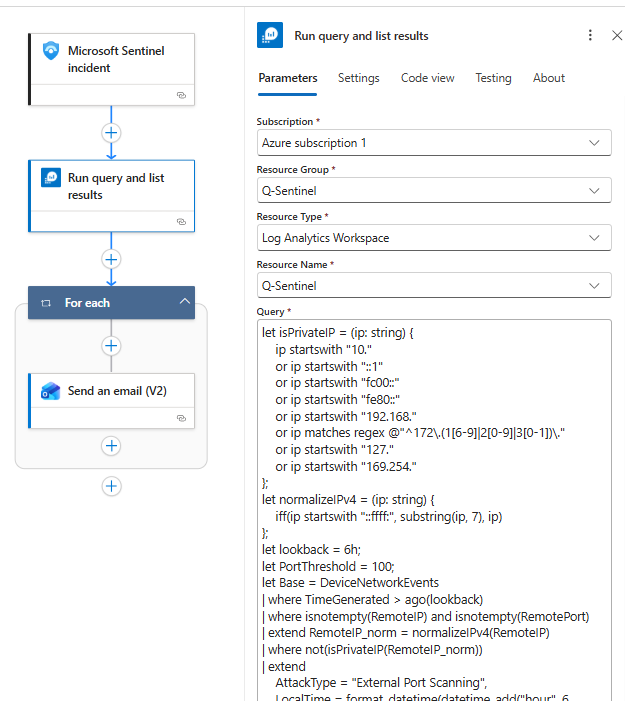
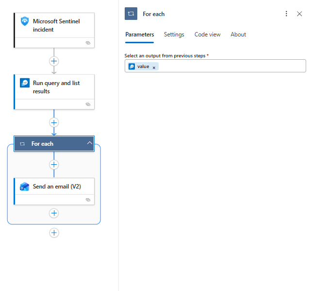
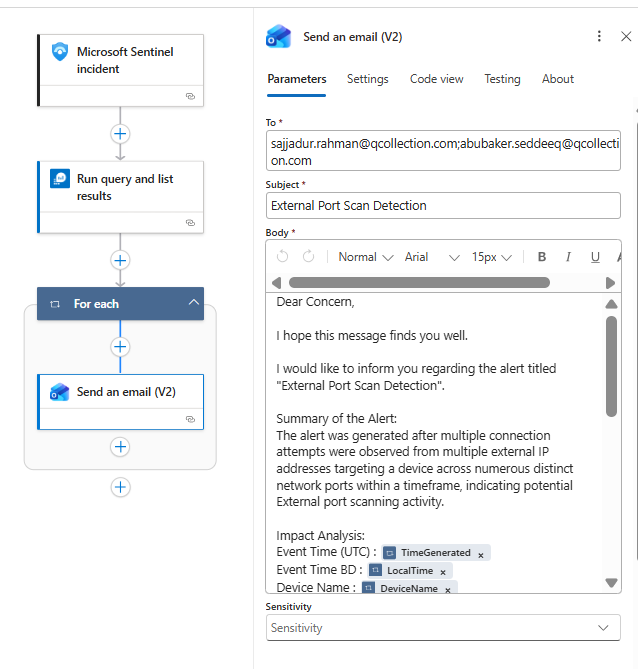

# External Port Scan







KQL:

```sql
let isPrivateIP = (ip: string) {
    ip startswith "10."
    or ip startswith "::1"
    or ip startswith "fc00::"
    or ip startswith "fe80::"
    or ip startswith "192.168."
    or ip matches regex @"^172\.(1[6-9]|2[0-9]|3[0-1])\."
    or ip startswith "127."
    or ip startswith "169.254."
};
let normalizeIPv4 = (ip: string) {
    iff(ip startswith "::ffff:", substring(ip, 7), ip)
};
let lookback = 6h;
let PortThreshold = 100;
let Base = DeviceNetworkEvents
| where TimeGenerated > ago(lookback)
| where isnotempty(RemoteIP) and isnotempty(RemotePort)
| extend RemoteIP_norm = normalizeIPv4(RemoteIP)
| where not(isPrivateIP(RemoteIP_norm))
| extend
    AttackType = "External Port Scanning",
    LocalTime = format_datetime(datetime_add("hour", 6, TimeGenerated), "yyyy-MM-dd HH:mm:ss");
let RemoteIPCounts = Base
| summarize RemoteIPCount = dcount(RemoteIP_norm) by DeviceName;
let PerPort = Base
| summarize
    Remote_IP = make_set(RemoteIP_norm, 300),
    LastSeenPort = max(TimeGenerated)
  by DeviceName, RemotePort
| extend
    PortNum = toint(RemotePort),
    PortToIPs = strcat(tostring(RemotePort), " : ", Remote_IP);
PerPort
| where isnotnull(PortNum)
| sort by DeviceName asc, PortNum asc
| summarize
    TimeGenerated = max(LastSeenPort),
    LocalTime = format_datetime(datetime_add("hour", 6, max(LastSeenPort)), "yyyy-MM-dd HH:mm:ss"),
    RemotePortCount = dcount(RemotePort),
    AttackType = any("External Port Scanning"),
    Port_IP = make_list(PortToIPs),
    RemotePort= make_set(RemotePort)
  by DeviceName
| join kind=leftouter RemoteIPCounts on DeviceName
| where RemotePortCount >= PortThreshold
```


Mail Format:
```
Dear Concern,

I hope this message finds you well.

I would like to inform you regarding the alert titled "External Port Scan Detection".

Summary of the Alert:
The alert was generated after multiple connection attempts were observed from multiple external IP addresses targeting a device across numerous distinct network ports within a timeframe, indicating potential External port scanning activity.

Impact Analysis:
Event Time (UTC) : @{item()?['TimeGenerated']}
Event Time BD : @{item()?['LocalTime']}
Device Name : @{item()?['DeviceName']}
Remote Port : IP Address = @{item()?['Port_IP']}

Remote IP Count : @{item()?['RemoteIPCount']}
Remote Port : @{item()?['RemotePort']}

Remote Port Count : @{item()?['RemotePortCount']}
Attack Type : @{item()?['AttackType']}

Cause of the Alert:
The analytics rule identified external IP addresses initiating connections to a single device on multiple unique destination ports, exceeding the defined port scan threshold.

Please review the activity to determine whether it is authorized.

If you require any additional clarification or assistance, please feel free to let us know.
Thanking you.

Regards,
SOC Team
ELEVATE SOLUTIONS LIMITED
```