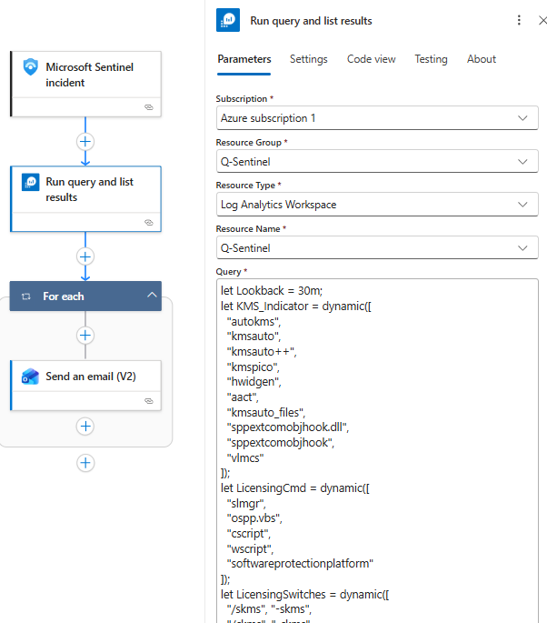
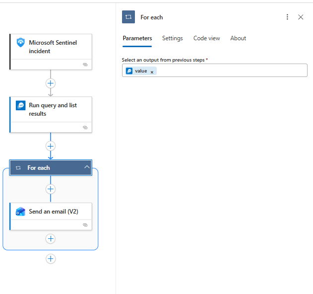
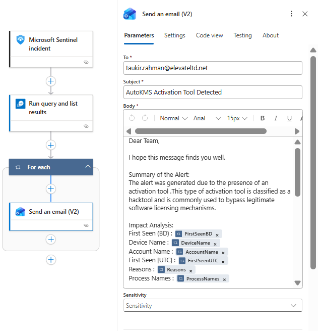

# KMS-Activation-Tool








Check [KQL query here](./KQL-Query.sql)

Mail Format :

```
Dear Team,

I hope this message finds you well.

Summary of the Alert:
The alert was generated due to the presence of an activation tool .This type of activation tool is classified as a hacktool and is commonly used to bypass legitimate software licensing mechanisms.

Impact Analysis:
First Seen (BD) : @{item()?['FirstSeenBD']}
Device Name : @{item()?['DeviceName']}
Account Name : @{item()?['AccountName']}
First Seen [UTC] : @{item()?['FirstSeenUTC']}
Reasons : @{item()?['Reasons']}
Process Names : @{item()?['ProcessNames']}

Command Lines : @{item()?['CmdLines']}


Initiators : @{item()?['Initiators']}
MD5 : @{item()?['InitiatingProcessMD5']}
Folder Path : @{item()?['InitiatingProcessFolderPath']}
File Size (MB) : @{item()?['File_Size_MB']}


Cause of the Alert:
The alert was triggered due to the execution and/or detection of a known activation tool (hacktool) on the endpoint, identified through process activity and file indicators matching commonly used unauthorized software activation utilities.

Please review the activity to determine whether it is authorized.

If you require any additional clarification or assistance, please feel free to let us know.
Thanking you.

Regards,
SOC Team
ELEVATE SOLUTIONS LIMITED
```
