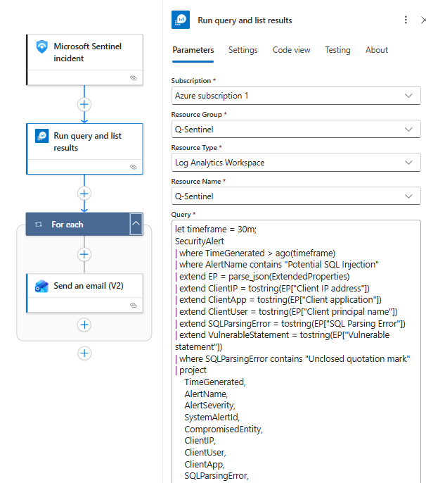
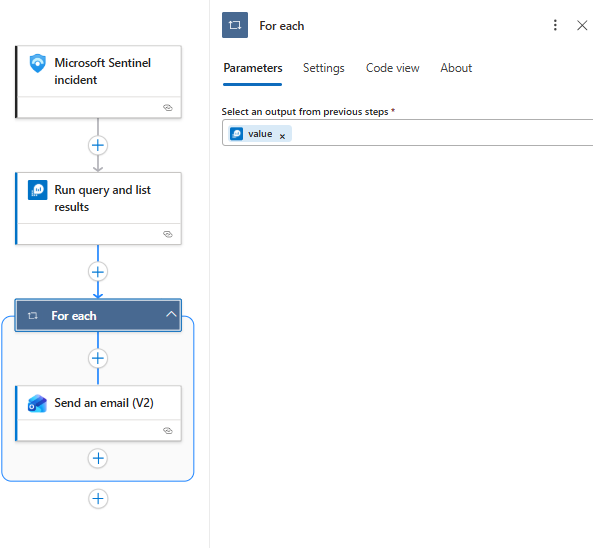
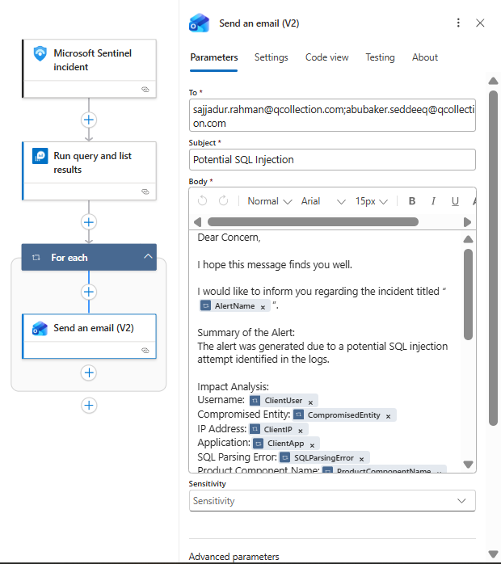

# Potential-SQL-Injection








KQL:

```sql
let timeframe = 30m;
SecurityAlert
| where TimeGenerated > ago(timeframe)
| where AlertName contains "Potential SQL Injection"
| extend EP = parse_json(ExtendedProperties)
| extend ClientIP = tostring(EP["Client IP address"])
| extend ClientApp = tostring(EP["Client application"])
| extend ClientUser = tostring(EP["Client principal name"])
| extend SQLParsingError = tostring(EP["SQL Parsing Error"])
| extend VulnerableStatement = tostring(EP["Vulnerable statement"])
| where SQLParsingError contains "Unclosed quotation mark"
| project
    TimeGenerated,
    AlertName,
    AlertSeverity,
    SystemAlertId,
    CompromisedEntity,
    ClientIP,
    ClientUser,
    ClientApp,
    SQLParsingError,
    ProductComponentName,
    Description
| order by TimeGenerated desc
```

Mail Format

```
Dear Concern,

I hope this message finds you well.

I would like to inform you regarding the incident titled “@{items('For_each')['AlertName']}”.

Summary of the Alert:
The alert was generated due to a potential SQL injection attempt identified in the logs.

Impact Analysis:
Username: @{item()?['ClientUser']}
Compromised Entity:@{item()?['CompromisedEntity']}
IP Address:@{item()?['ClientIP']}
Application:@{item()?['ClientApp']}
SQL Parsing Error:@{item()?['SQLParsingError']}
Product Component Name:@{item()?['ProductComponentName']}
Alert Severity:@{item()?['AlertSeverity']}
System Alert ID: @{item()?['SystemAlertId']}
Description: @{item()?['Description']}

Cause of the Alert:
The alert was triggered due to detection of an SQL parsing error indicating an unclosed quotation mark, which may suggest malicious SQL input.

Please review the activity to determine whether it is authorized.

If you require any additional clarification or assistance, please feel free to let us know.
Thanking you.

Regards,
SOC Team
ELEVATE SOLUTIONS LIMITED
```