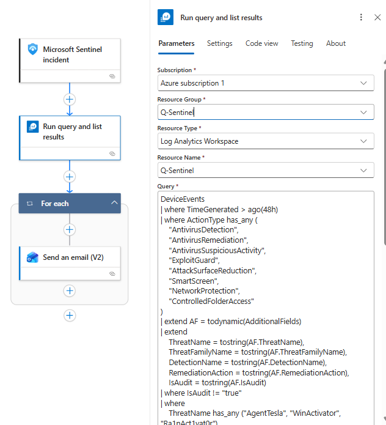
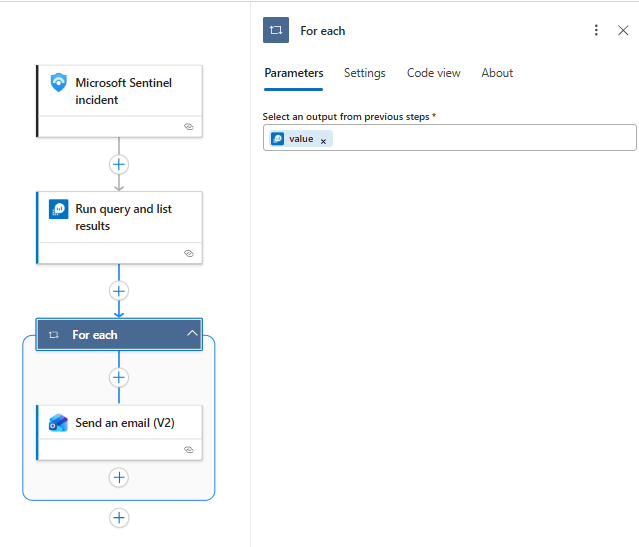

# Process Kill





KQL:

```sql
DeviceEvents
| where TimeGenerated > ago(48h)
| where ActionType has_any (
    "AntivirusDetection",
    "AntivirusRemediation",
    "AntivirusSuspiciousActivity",
    "ExploitGuard",
    "AttackSurfaceReduction",
    "SmartScreen",
    "NetworkProtection",
    "ControlledFolderAccess"
)
| extend AF = todynamic(AdditionalFields)
| extend
    ThreatName = tostring(AF.ThreatName),
    ThreatFamilyName = tostring(AF.ThreatFamilyName),
    DetectionName = tostring(AF.DetectionName),
    RemediationAction = tostring(AF.RemediationAction),
    IsAudit = tostring(AF.IsAudit)
| where IsAudit != "true"
| where
    ThreatName has_any ("AgentTesla", "WinActivator", "Ra1nAct1vat0r")
    or ThreatFamilyName has_any ("AgentTesla", "WinActivator", "Ra1nAct1vat0r")
    or DetectionName has_any ("AgentTesla", "WinActivator", "Ra1nAct1vat0r")
| where
    not(ThreatName has_any ("Cerber", "Cerberus", "Creber"))
    and not(ThreatFamilyName has_any ("Cerber", "Cerberus", "Creber"))
    and not(DetectionName has_any ("Cerber", "Cerberus", "Creber"))
| project
    TimeGenerated,
    DeviceName,
    AccountName,
    ActionType,
    ThreatFamilyName,
    ThreatName,
    DetectionName,
    RemediationAction,
    FileName,
    FolderPath,
    SHA1,
    InitiatingProcessFileName,
    InitiatingProcessCommandLine
| order by TimeGenerated desc
| take 200
```
