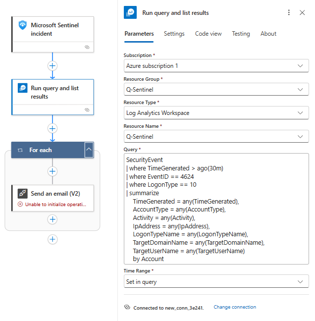
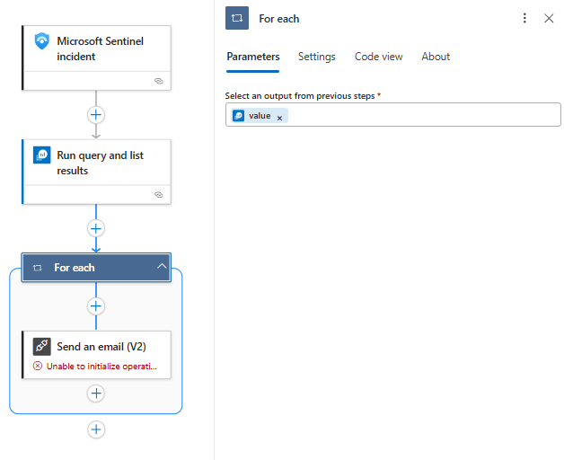

# RDP-Logon-Detection






KQL: 

```sql
SecurityEvent
| where TimeGenerated > ago(30m)
| where EventID == 4624
| where LogonType == 10
| summarize 
    TimeGenerated = any(TimeGenerated),
    AccountType = any(AccountType),
    Activity = any(Activity),
    IpAddress = any(IpAddress),
    LogonTypeName = any(LogonTypeName),
    TargetDomainName = any(TargetDomainName),
    TargetUserName = any(TargetUserName)
    by Account
```

