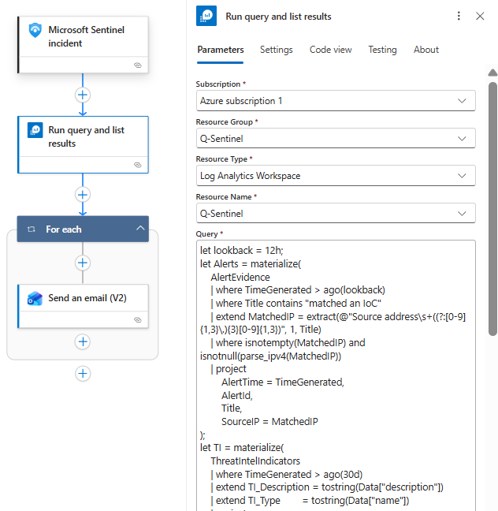
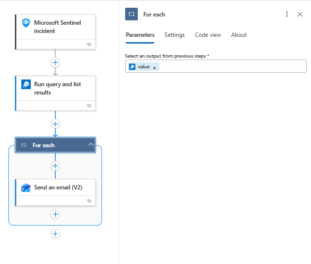
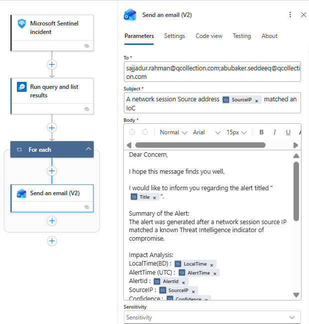

# TI-IoC-Match-Network-Session








KQL:

```sql
let lookback = 12h;
let Alerts = materialize(
    AlertEvidence
    | where TimeGenerated > ago(lookback)
    | where Title contains "matched an IoC"
    | extend MatchedIP = extract(@"Source address\s+((?:[0-9]{1,3}\.){3}[0-9]{1,3})", 1, Title)
    | where isnotempty(MatchedIP) and isnotnull(parse_ipv4(MatchedIP))
    | project 
        AlertTime = TimeGenerated,
        AlertId,
        Title,
        SourceIP = MatchedIP
);
let TI = materialize(
    ThreatIntelIndicators
    | where TimeGenerated > ago(30d)
    | extend TI_Description = tostring(Data["description"])
    | extend TI_Type        = tostring(Data["name"])
    | project 
        TI_Time = TimeGenerated,
        ObservableValue,
        Confidence,
        TI_Description,
        TI_Type
    | summarize arg_max(TI_Time, Confidence, TI_Description, TI_Type) by ObservableValue
);
Alerts
| join kind=inner hint.strategy=broadcast (TI) on $left.SourceIP == $right.ObservableValue
| summarize
    AlertTime      = max(AlertTime),
    Title          = any(Title),
    SourceIP       = any(SourceIP),
    Confidence     = max(Confidence),
    TI_Description = any(TI_Description),
    TI_Type        = any(TI_Type)
  by AlertId
| extend LocalTime = format_datetime(datetime_add("hour", 6, AlertTime), "dd-MM-yyyy HH:mm:ss.fff")
| order by AlertTime desc
```

Mail Format:

```
Dear Concern,

I hope this message finds you well.

I would like to inform you regarding the alert titled "@{item()?['Title']}".

Summary of the Alert:
The alert was generated after a network session source IP matched a known Threat Intelligence indicator of compromise.

Impact Analysis:
LocalTime(BD) : @{item()?['LocalTime']}
AlertTime (UTC) : @{item()?['AlertTime']}
AlertId : @{item()?['AlertId']}
SourceIP : @{item()?['SourceIP']}
Confidence : @{item()?['Confidence']}
TI_Description : @{item()?['TI_Description']}
TI_Type : @{item()?['TI_Type']}

Cause of the Alert:
A network session source IP matched a known Threat Intelligence indicator of compromise.

Please review the activity to determine whether it is authorized.

If you require any additional clarification or assistance, please feel free to let us know.
Thanking you.

Regards,
SOC Team
ELEVATE SOLUTIONS LIMITED
```

