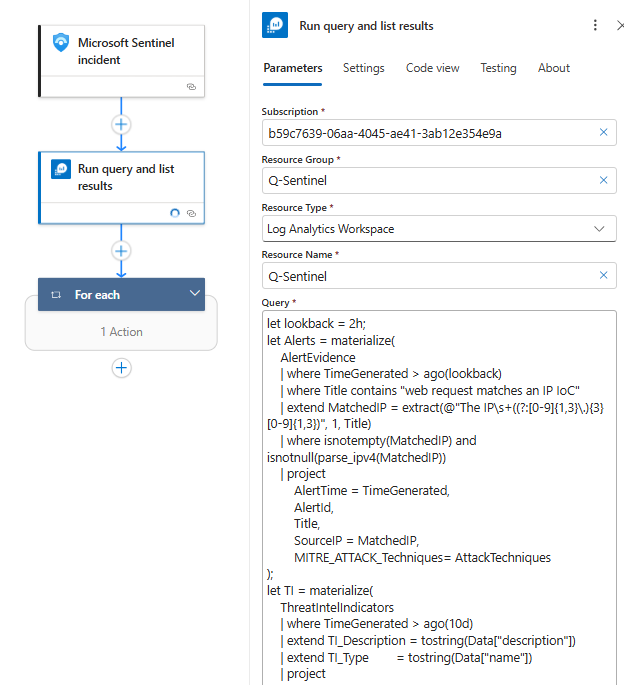
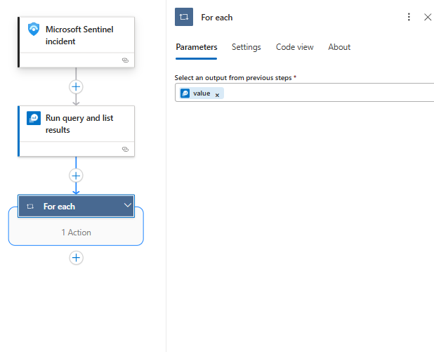
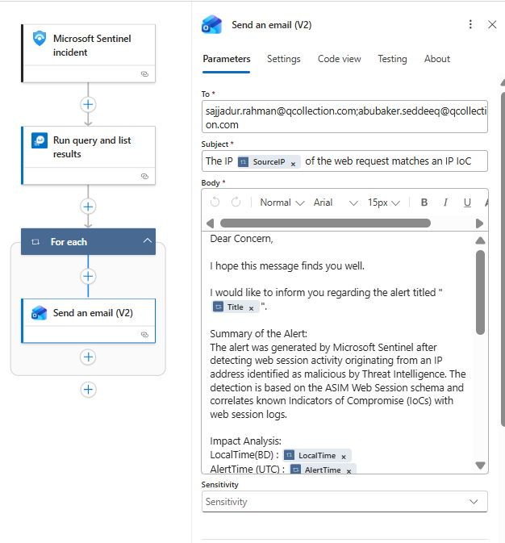

# TI-IoC-Match-Web-Request







KQL:

```sql
let lookback = 2h;
let Alerts = materialize(
    AlertEvidence
    | where TimeGenerated > ago(lookback)
    | where Title contains "web request matches an IP IoC"
    | extend MatchedIP = extract(@"The IP\s+((?:[0-9]{1,3}\.){3}[0-9]{1,3})", 1, Title)
    | where isnotempty(MatchedIP) and isnotnull(parse_ipv4(MatchedIP))
    | project 
        AlertTime = TimeGenerated,
        AlertId,
        Title,
        SourceIP = MatchedIP,
        MITRE_ATTACK_Techniques= AttackTechniques
);
let TI = materialize(
    ThreatIntelIndicators
    | where TimeGenerated > ago(10d)
    | extend TI_Description = tostring(Data["description"])
    | extend TI_Type        = tostring(Data["name"])
    | project 
        TI_Time = TimeGenerated,
        ObservableValue,
        Confidence,
        TI_Description,
        TI_Type
    | summarize arg_max(TI_Time, Confidence, TI_Description, TI_Type) by ObservableValue
);
Alerts
| join kind=inner hint.strategy=broadcast (TI) on $left.SourceIP == $right.ObservableValue
| summarize
    AlertTime      = max(AlertTime),
    Title          = any(Title),
    SourceIP       = any(SourceIP),
    Confidence     = max(Confidence),
    TI_Description = any(TI_Description),
    TI_Type        = any(TI_Type)
  by AlertId
| extend LocalTime = format_datetime(datetime_add("hour", 6, AlertTime), "dd-MM-yyyy HH:mm:ss.fff")
| order by AlertTime desc
```

Mail Format:

```
Dear Concern,

I hope this message finds you well.

I would like to inform you regarding the alert titled "@{item()?['Title']}".

Summary of the Alert:
The alert was generated by Microsoft Sentinel after detecting web session activity originating from an IP address identified as malicious by Threat Intelligence. The detection is based on the ASIM Web Session schema and correlates known Indicators of Compromise (IoCs) with web session logs.

Impact Analysis:
LocalTime(BD) : @{item()?['LocalTime']}
AlertTime (UTC) : @{item()?['AlertTime']}
AlertId : @{item()?['AlertId']}
SourceIP : @{item()?['SourceIP']}
Confidence : @{item()?['Confidence']}
TI_Description : @{item()?['TI_Description']}
TI_Type : @{item()?['TI_Type']}

Cause of the Alert:
The alert was triggered due to a match between a known malicious IP address from Threat Intelligence and web session activity recorded in ASIM-compliant web session logs.

Please review the activity to determine whether it is authorized.

If you require any additional clarification or assistance, please feel free to let us know.
Thanking you.

Regards,
SOC Team
ELEVATE SOLUTIONS LIMITED
```